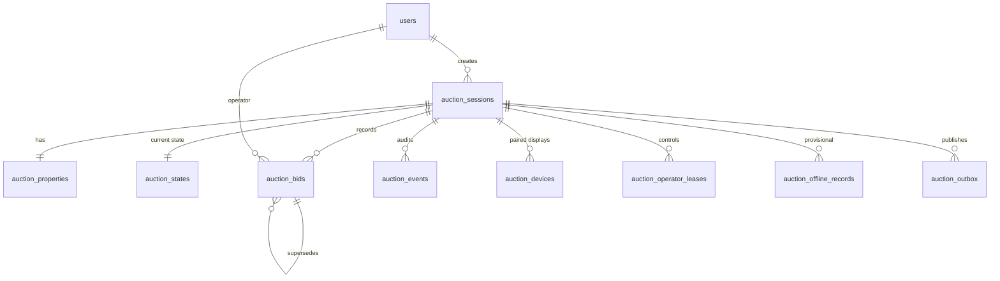

# Database Design (MySQL 8, InnoDB, utf8mb4)

All money is `BIGINT UNSIGNED` **cents**. All timestamps are server-generated `TIMESTAMP(6)` UTC.

## ERD



## Tables

### users
Laravel default + `role ENUM('operator','admin','viewer')`, `is_active BOOL`.

### auction_sessions
| column | type | notes |
|---|---|---|
| id | CHAR(26) PK | ULID |
| title | VARCHAR(190) | |
| scheduled_at | TIMESTAMP | |
| auctioneer_name | VARCHAR(120) | |
| default_increment_cents | BIGINT UNSIGNED | |
| reserve_cents | BIGINT UNSIGNED NULL | **private** |
| internal_notes | TEXT NULL | **private** |
| created_by | FK users | |
| timestamps | | |

### auction_properties
`id`, `session_id` FK UNIQUE, `address_line`, `suburb`, `city`, `hero_image_path`, `listing_ref`.

### auction_states (1 row per session — the authoritative current state)
| column | type | notes |
|---|---|---|
| session_id | PK/FK | |
| session_status | ENUM('NOT_STARTED','LIVE','PAUSED','ENDED') | |
| sale_status | ENUM('NONE','ON_THE_MARKET','SOLD','PASSED_IN') | separate field |
| current_bid_id | FK auction_bids NULL | |
| current_bid_cents | BIGINT UNSIGNED NULL | denormalised |
| bid_count | INT UNSIGNED | active bids |
| state_version | BIGINT UNSIGNED | +1 on every mutation |
| event_seq | BIGINT UNSIGNED | last event sequence |
| updated_at | TIMESTAMP(6) | |

Updated with `SELECT … FOR UPDATE` inside each command transaction.

### auction_bids (append-only)
| column | type | notes |
|---|---|---|
| id | CHAR(26) PK | |
| session_id | FK | |
| seq | INT UNSIGNED | per-session bid sequence |
| amount_cents | BIGINT UNSIGNED | |
| status | ENUM('ACTIVE','REVERSED','CORRECTED') | only status changes, never amount |
| supersedes_bid_id | FK auction_bids NULL | correction points to original |
| operator_id | FK users | |
| idempotency_key | CHAR(36) | |
| source | ENUM('CLOUD','OFFLINE_IMPORT') | |
| created_at | TIMESTAMP(6) | |

UNIQUE(`session_id`,`seq`), UNIQUE(`session_id`,`idempotency_key`), INDEX(`session_id`,`status`,`seq`).

> Status transitions on bids are themselves recorded as events; the bid row's `status` is a projection for fast reads.

### auction_events (immutable audit log)
| column | type |
|---|---|
| id | BIGINT PK AI |
| session_id | FK |
| seq | BIGINT UNSIGNED — UNIQUE(session_id, seq) |
| type | VARCHAR(40) — `AUCTION_STARTED`, `BID_ACCEPTED`, `BID_CORRECTED`, `BID_UNDONE`, `PAUSED`, `RESUMED`, `ON_THE_MARKET`, `SOLD`, `PASSED_IN`, `AUCTION_ENDED`, `OPERATOR_TAKEOVER`, `OPERATOR_ACQUIRED`, `OPERATOR_RELEASED`, `DISPLAY_PAIRED`, `DISPLAY_REVOKED`, `OFFLINE_IMPORTED` |
| previous_state | JSON |
| new_state | JSON |
| operator_id | FK users NULL |
| state_version | BIGINT UNSIGNED |
| reason | VARCHAR(500) NULL |
| idempotency_key | CHAR(36) NULL |
| created_at | TIMESTAMP(6) |

DB user for the app has **no UPDATE/DELETE grant** on this table. Optional `hash_chain CHAR(64)` = sha256(prev_hash ‖ row) for tamper evidence.

### auction_devices
`id`, `session_id` FK, `label`, `token_hash` (sha256), `pairing_code_hash` NULL, `pairing_expires_at`, `approved_by` FK users NULL, `approved_at`, `revoked_at` NULL, `last_heartbeat_at`, `last_acked_version`, `user_agent`. INDEX(`session_id`,`revoked_at`).

### auction_operator_leases
`id`, `session_id` FK, `user_id` FK, `lease_token` CHAR(36), `acquired_at`, `renewed_at`, `expires_at`, `released_at` NULL, `taken_over_by` FK NULL.  
Exactly one active lease: enforced in the transaction via `SELECT … FOR UPDATE` on `auction_states`, plus generated column `active_session_id = IF(released_at IS NULL, session_id, NULL)` with UNIQUE index.

### auction_offline_records
`id`, `session_id`, `local_id` CHAR(36) UNIQUE, `device_label`, `record_type`, `payload` JSON, `local_created_at`, `uploaded_by`, `uploaded_at`, `decision ENUM('PENDING','IMPORTED','DISCARDED')`, `decided_by`, `decided_at`, `decision_reason`, `resulting_event_id` NULL.

### auction_outbox
`id` BIGINT AI, `session_id`, `state_version`, `channel`, `payload` JSON, `created_at`, `published_at` NULL, `attempts`, `last_error`. INDEX(`published_at`,`id`).

### idempotency_requests
`key` CHAR(36) PK, `user_id`, `route`, `request_hash`, `status ENUM('PROCESSING','COMPLETED','FAILED')`, `response_code`, `response_body` JSON, `created_at`, `expires_at`. Lets a client ask "did my request commit?" after a lost response.

## Transaction boundary (every command)

```
BEGIN
  SELECT * FROM auction_states WHERE session_id=? FOR UPDATE
  verify lease, expected_version == state_version, state-machine rule
  INSERT auction_bids / UPDATE projection columns
  INSERT auction_events (seq = event_seq+1, state_version = v+1)
  UPDATE auction_states SET state_version=v+1, event_seq=…
  INSERT auction_outbox (public payload, v+1)
  UPDATE idempotency_requests SET status='COMPLETED', response_body=…
COMMIT
→ dispatch outbox relay
```
